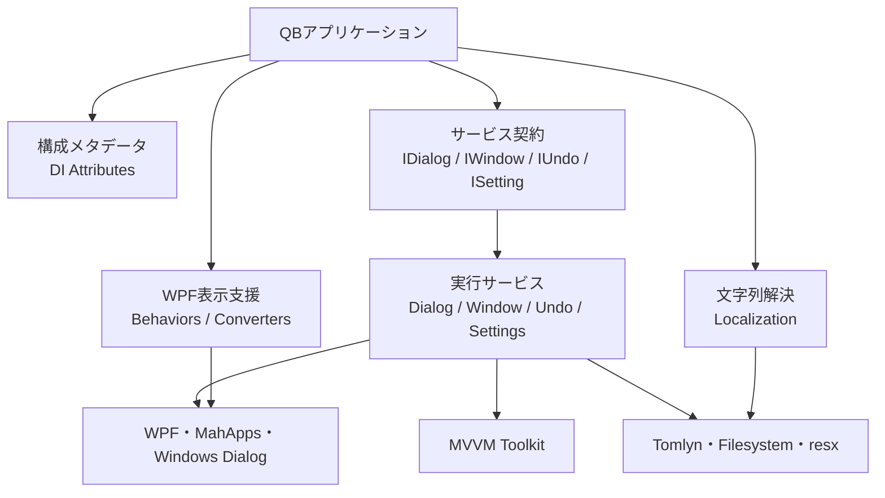
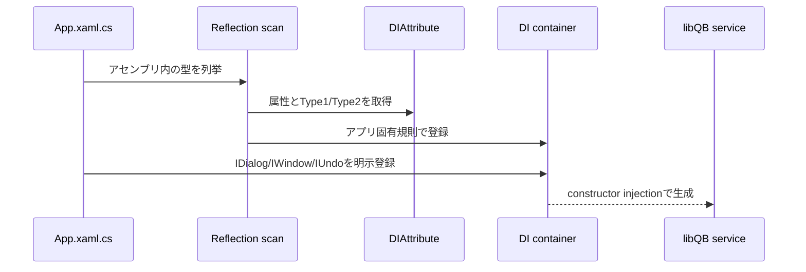
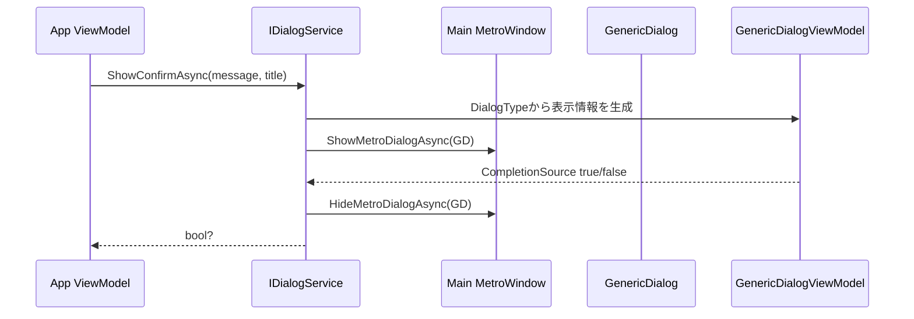
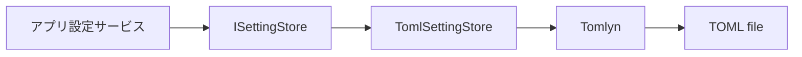
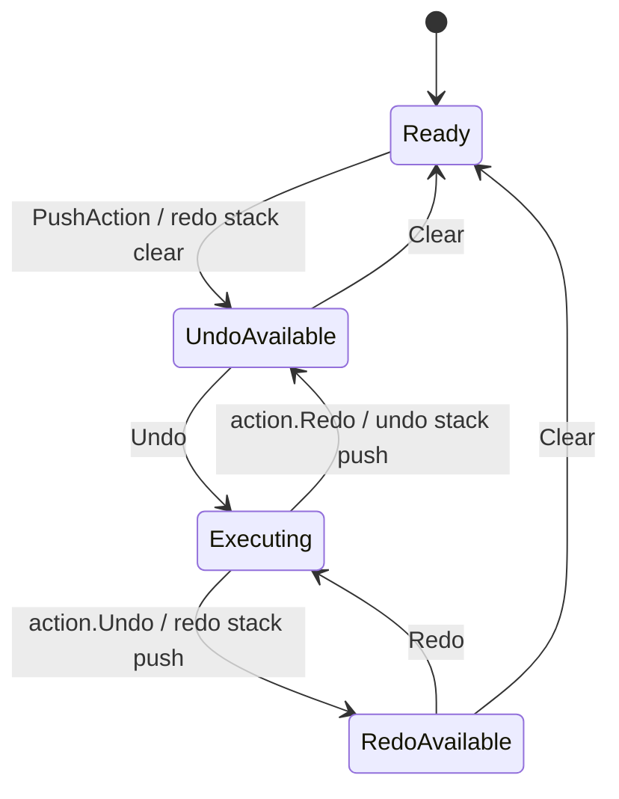

# libQB アーキテクチャ

## 1. 調査方針

GraphifyのCommunity、God Nodes、接続情報を最初の構造理解に利用し、その後に全C#／XAMLと `libQB.csproj` を確認した。本書の章名はGraphifyのCommunity名をそのまま転記せず、実コードから読み取れる開発者向けの責務名に整理している。Graphifyが示す「接続」は、設計上の依存、継承、ドキュメント上の言及など性質が異なるため、問題とは即断しない。

## 2. 全体構造

libQBは、アプリ層の下で横断的なWPF機能を提供するフラットな共通基盤である。厳密な多層アーキテクチャではないが、実装上は次の責務層に分けられる。



重要なのは、libQBがアプリのComposition Rootを持たない点である。DI属性は登録意図を表すだけであり、スキャンとコンテナー登録は各QBアプリの `App.xaml.cs` に置かれている。

## 3. Graphify Communityと実コード上の責務

Graphifyは289 nodes、371 edges、19 communities（18表示、thin community 1件省略）を報告した。型だけでなく.NET標準型、プロパティ、README、ライセンス、パッケージもノードに含むため、Community数をそのままモジュール数とは見なさない。

| Graphify Community | 本書で整理した責務 | 実コードによる評価 |
|---|---|---|
| Undo/Redo Manager | 操作履歴管理 | interface、manager、単一／複合actionがまとまっており自然 |
| Localization Manager | 文字列解決と言語パック | discovery、保持、解決、Binding通知という一連の責務 |
| Value Converters | Binding値変換 | 独立した小型converterの配置単位 |
| Window Service | モーダルWindow起動と結果返却 | 契約と実装、補助interfaceで一貫 |
| Dialog Service Interfaces / Implementation / Generic Dialog View / ViewModel | 共通ダイアログ | Graphify上はUI・VM・serviceで分かれるが、実装上は単一機能の協調部品 |
| UI Behaviors / DataGrid Extend / Clearable ComboBox / Focus Validation | WPFコントロール拡張 | 汎用Behavior群。大きいDataGridだけ別communityになるのは接続数によるもの |
| DI Attributes | DI登録メタデータ | アプリ側Composition Rootへの受け渡し境界 |
| Settings Store | 設定永続化抽象 | interfaceとTOML adapterの小さなまとまり |
| Base Theme Enum | テーマ識別子 | 単一Enum。テーマ適用は消費側責務 |
| Project Documentation / Dependencies | 配布・プロジェクト情報 | ランタイム責務ではないため構造図の層から分離 |

Community分割は、フォルダー／名前空間の責務を概ね適切に反映する。DialogとBehaviorが細分化されているのはGraphifyのノード接続に基づく結果であり、コード上で別サブシステムに分離されていることを意味しない。

## 4. フォルダーと名前空間

```text
libQB
├─ Attributes          DI登録メタデータ
├─ Behaviors           WPF Behavior・添付プロパティ
├─ DialogServices      OS／MahAppsダイアログ
├─ Enums               共通Enum
├─ Localization        ResourceManager・外部resx統合
├─ Settings            設定ストア抽象とTOML実装
├─ UndoRedo            操作履歴
├─ ValueConverters     WPF Binding変換
└─ WindowServices      Window生成・ViewModel DI解決・結果返却
```

フォルダーと名前空間は一致しており、異なる責務間の直接依存は限定的である。代表的な内部依存はサービス実装から `libQB.Attributes` への依存、`ClearableComboBox` から `DialogTextProvider` への文言依存である。Graphifyはimport cycleなしと報告し、実コード確認でも循環する名前空間依存は確認できなかった。

## 5. DI構成

`DIAttribute` は `Type1` / `Type2` を保持するメタデータ基底である。派生属性はWindow、Page、UserControl、Singletonの登録意図を型引数で表す。



`DialogService`、`WindowService`、`UndoManager` にはそれぞれ `[DISingleton<I...>]` がある。ただし参照先のアプリは自アセンブリをスキャンするため、libQBサービスは明示的に `AddSingleton` している例が多い。属性だけで実行時登録が完了するわけではない。

## 6. Localization

Localizationは、外部パックの値を第一候補、登録済みResourceManagerを第二候補としてfull keyを解決する。

```mermaid
flowchart LR
    XAML[LocExtension] --> Indexer[LocalizationManager indexer]
    Code[Resolve] --> Override{外部packに<br/>group/keyがあるか}
    Indexer --> Override
    Override -- Yes --> External[外部resxの値]
    Override -- No --> Manager{ResourceManagerが<br/>登録済みか}
    Manager -- Yes --> BuiltIn[現在Cultureの組み込み値]
    Manager -- No --> Fallback[null / XAML Fallback]
    SetCulture[SetCulture] --> Notify[PropertyChanged Item[]]
    Notify --> XAML
```

`Initialize` は指定ルート直下の各サブフォルダーをカルチャコードとして扱い、各フォルダー直下の `*.resx` を `LanguagePack` に読む。`LocExtension` はManagerのインデクサにOneWay Bindingするため、現在実装では `SetCulture` の `Item[]` 通知を介して表示中Bindingの再評価が可能である。

libQBは初期化パス、ResourceManagerの登録内容、選択言語の保存、初期化タイミングを決めない。これらはアプリ側の責務である。なお既存 `docs/Localization/Specification.md` にはLocExtensionが一度だけ評価される旨など、現在コードと一致しない説明が残っている。

## 7. DialogService



通知・警告・確認は `GenericDialogOptions.Create` がタイトル、Material icon、色、キャンセルボタン、Yes/No文言を決める。文言は `DialogTextProvider` のdelegateを通すため、アプリがLocalizationに接続できる。OSのOpen/Save/Folderダイアログも同じinterfaceにまとめられているが、MahAppsオーバーレイとは別のWindows標準APIである。

Graphifyで `DialogService` が最大のGod Nodeになった理由は、interface実装、MainWindow、複数ダイアログAPI、Options、View、ViewModel、MahAppsとの接点が集中するためである。役割は「ダイアログの単一ファサード」として理解でき、接続数だけから責務過多とは判断できない。

## 8. WindowService

WindowServiceは入力を伴う専用Windowなどを、アプリのViewModelから直接構築せず開くための薄いサービスである。

1. `TWindow` を `new()` する。
2. `TViewModel` を `IServiceProvider.GetService` で解決する。
3. callback版では `IParameterReceiver` に入力を渡す。
4. ViewModelをDataContextに設定し、ownerが明示された場合だけ設定する。
5. `ShowDialog()` でモーダル表示する。
6. callback版ではClosed後に `IResultProvider<TResult>` から結果を返す。

`IWindowClosingAware` はサービス自身では使わず、アプリ側WindowのClosing処理がViewModelへ終了可否を問い合わせる契約として利用されている。

## 9. Settings

SettingsはgenericなPort/Adapter構成である。



保存先パスと設定型は呼び出し側が決める。`Load` はファイル不存在またはTomlynの `TryDeserialize` 失敗時に既定インスタンスを返す。保存先ディレクトリ作成、マイグレーション、検証、暗号化はこの層の責務ではない。

## 10. Undo/Redo



Command Patternとして `IUndoableAction` が処理を抽象化する。`PropertyChangeAction<T>` は式木からsetterを生成し、`CompoundUndoableAction` は複数actionをひとつの履歴単位にする。`UndoManager` の `_isExecutingUndoRedo` はUndo/Redo中のプロパティ変更監視が同じ変更を再登録することを防ぐための状態である。QBDrumMapでは複数プロパティ変更をcompoundとして登録する実例を確認した。

## 11. UI拡張

BehaviorとConverterはサービス層へ入らず、XAML BindingやWPFイベントをViewModel向けの状態／Commandに橋渡しする。特に `DataGridExtendBehavior` は編集状態、選択行、Delete、Sortという複数のDataGridイベントを集約するため、Graphify上の接続数が多い。これはDataGrid適応層という現在の責務から自然に生じる接続である。

`ClearableComboBox` から `DialogTextProvider` への依存は、クリアボタンtooltipをアプリの言語設定に合わせるための横断接続である。BehaviorからDialogServices名前空間への依存ではあるが、ダイアログ表示への依存ではない。

## 12. Graphifyレビュー

### 12.1 Community

- 妥当な責務分割: Undo/Redo、Localization、Window、Settings、DI属性、Converterはフォルダー／名前空間と対応し、理解しやすい。
- Dialog関連: interface、実装、View、ViewModelが別Communityだが、実コードでは共通ダイアログという1つの責務を構成する。分離自体はMVVMとファサードの境界を反映している。
- UI Behavior関連: DataGrid等が独立Communityになるのは個別BehaviorがWPF型と多く接続するためであり、Behavior間が密結合しているわけではない。
- 気になる依存: `ClearableComboBox` → `DialogTextProvider` は名前空間境界を越える。ただし目的はtooltip文言の差し替えであり、現在の設計意図は自然に説明できる。
- 孤立ノード: Graphifyは27件を報告した。例示された `IconKind`, `IconColor`, `Title`, `Message`, `OkButtonText` はGenericDialogのbindable propertyであり、XAML Bindingやsource-generated memberが解析上弱く接続されたものと読める。孤立だけを根拠に未使用とは判断しない。
- 密結合: 最大でも14 edgesで、import cycleはない。DialogとLocalizationは協調型が多く中心性が上がるが、コード上で全モジュールを巻き込む循環依存は確認できない。

### 12.2 God Nodes

| God Node | 中心になる理由 | 現在の責務評価 | 改善候補の判断 |
|---|---|---|---|
| `DialogService` | OSダイアログ、MahApps、Options、View/VM、interfaceの接点 | 共通ダイアログのファサードとして理解可能 | OSダイアログとMahApps表示の分離余地はあるが、現規模で必要とは断定できない |
| `DataGridExtendBehavior` | 多数のDependencyPropertyとDataGridイベント | DataGridとViewModelの適応層として一貫 | 機能単位Behaviorへの分割余地はあるが、同時利用要件が不明なため判断保留 |
| `LocalizationManager` | 言語一覧、パック、ResourceManager、Culture、通知を統括 | 文字列解決の単一窓口として整合 | discoveryとresolutionの分離余地はあるが、現状の利用規模では断定不可 |
| `BaseMetroDialog` | `GenericDialog` のフレームワーク基底 | 外部ライブラリの中心型でlibQBの責務ではない | 対象外 |
| `IDialogService` | 多種類のダイアログ契約を公開 | 呼び出し側の単一窓口 | interface segregationの余地はあるが利用実態は共通注入を支持 |
| `libQB (.NET Library)` | README・依存・機能群を束ねる概念ノード | コード型ではない | 対象外 |
| `UndoManager` | stack、action、通知、状態制御を統括 | 履歴管理として適切 | 履歴制限等の要件がないため分割根拠なし |
| `ClearableComboBox` | DependencyProperty、visual tree、button event、文言に接続 | 単一UI拡張だが内部処理は複合的 | ControlTemplate前提の整理余地はあるが、現利用での問題は確認していない |
| `GenericDialogViewModel` | 表示プロパティ、command、completionを仲介 | 単一Dialog VMとして適切 | 分割不要と考えられる |
| `IUndoManager` | action登録と状態・実行契約の中心 | Undo/Redo利用者向け窓口として適切 | 現状は小規模で分割根拠なし |

### 12.3 Surprising Connections

Graphifyが列挙した接続を実コードで確認した結果は次のとおりである。

| 接続 | 評価 |
|---|---|
| library → MIT License | READMEからライセンスへの文書リンクであり、ランタイム依存ではない。自然 |
| `DialogService` implements `IDialogService` | 明示的なinterface実装。自然 |
| `GenericDialog` inherits `BaseMetroDialog` | MahApps上でカスタムオーバーレイを表示するための基底。自然 |
| `LocalizationManager` references `LanguageInfo` | 利用可能言語一覧のDTO。自然 |
| `LocalizationManager` references `LanguagePack` | 外部言語パックの保持・解決対象。自然 |

いずれも実装責務から説明でき、見直しが必要な「意外な結合」とは確認できなかった。

GraphifyのSuggested Questionにある `libQB.Attributes` とUndo/Redo／Windowの橋渡しは、サービス実装にDI属性が付くためである。`IUndoManager` とLocalization間の橋渡しについては、実コードに直接依存がなく、同名標準型や文書ノード等を含むグラフ上の経路である可能性がある。提供レポートだけでは根拠となる具体的edgeを特定できないため、設計上の依存とは断定しない。

## 13. 考察・改善候補

以下は現状説明ではなく、実装との差異または保守時に確認価値がある候補である。

- READMEの対象SDK／Framework表記を現在の `net10.0-windows7.0` と整合させる。
- READMEの個人利用限定表現とMITライセンス本文の関係を整理する。
- 既存Localization仕様書を、現在の `LocExtension` のBinding実装と `RegisterResourceManager` フォールバックに合わせて更新する。
- `ClearableComboBox.ClearValue`、`WindowService.Owner`、`ShowWindow` の `parameter` など、公開されているが現在処理で使われないAPIの意図を確認する。
- `MahApps.Metro.IconPacks.FontAwesome` の直接利用がないため、パッケージ参照が消費側への推移依存提供を意図したものか確認する。

これらはコード変更の提案を本文の現状構造へ混在させないため、本章に分離した。要件・互換性・過去経緯を確認していないため、削除や分割が必要とは断定しない。

