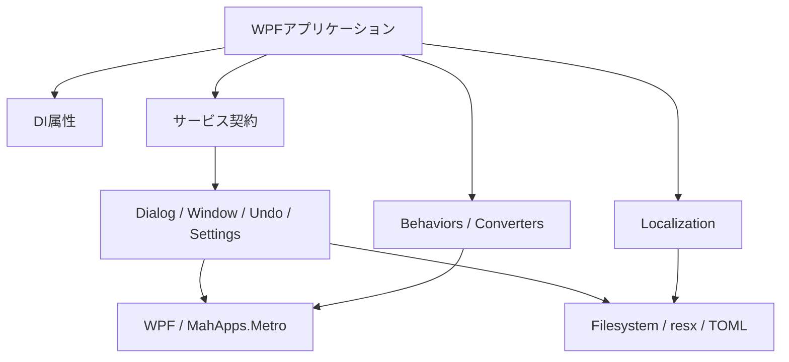
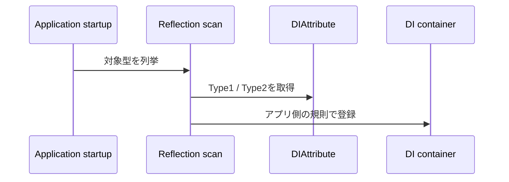
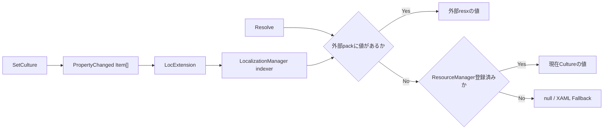
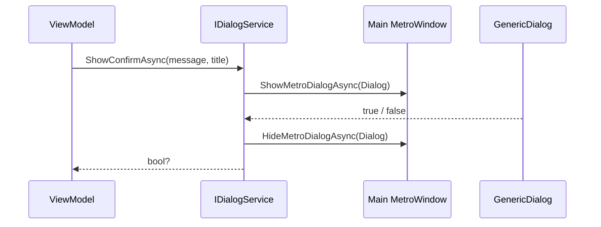
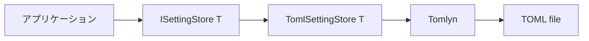
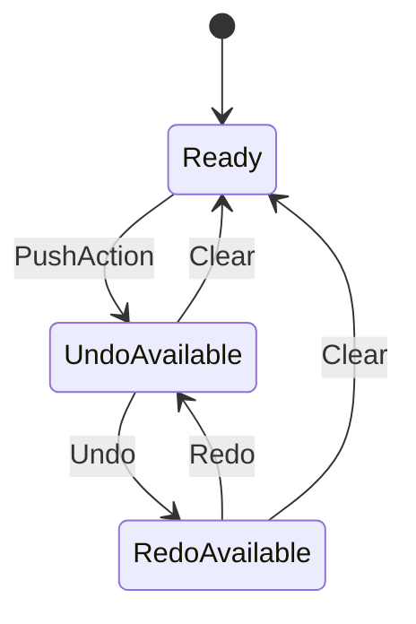

# libQB アーキテクチャ

## 全体構成

libQBは、WPFアプリケーションから利用する共通基盤ライブラリです。アプリケーションのComposition Rootは持たず、サービス契約、実装、WPF表示支援、永続化アダプターを提供します。



DIコンテナーの構築、属性スキャン、サービス登録は利用側アプリケーションが担当します。

## モジュール

```text
libQB
├─ Attributes          DI登録メタデータ
├─ Behaviors           WPF Behavior・添付プロパティ
├─ DialogServices      OS／MahAppsダイアログ
├─ Enums               共通Enum
├─ Localization        ResourceManager・外部resx統合
├─ Settings            設定ストア抽象とTOML実装
├─ UndoRedo            Undo/Redo履歴
├─ ValueConverters     WPF Binding変換
└─ WindowServices      モーダルWindow表示
```

各フォルダーは同名の名前空間に対応しています。

## DI属性

`DIAttribute` と派生属性は、型の登録方法を表すメタデータです。属性を読み取ってDIコンテナーへ登録する処理は含まれません。



`DialogService`、`WindowService`、`UndoManager` にはSingleton登録の意図を表す属性が付与されています。利用側のスキャナーがlibQBアセンブリを対象にしない場合は、各サービスを明示的に登録してください。

## Localization

Localizationは、外部言語パックと利用側が登録したResourceManagerを、同じfull keyで解決します。外部パックの値が優先され、値がない場合はResourceManagerへフォールバックします。



`Initialize` は指定ルート直下のサブフォルダーをカルチャコードとして扱い、各フォルダー直下の `*.resx` を読み込みます。`SetCulture` は `Item[]` のPropertyChanged通知を発行し、`LocExtension` が作成したBindingを再評価します。

libQB自身は組み込みresxを持たず、ResourceManagerを自動登録しません。初期化パス、ResourceManager、選択言語の保存は利用側で構成してください。

## DialogService

`DialogService` は次の2種類のダイアログを1つのインターフェースで提供します。

- Windows標準のOpen、Save、Folderダイアログ
- MahApps.Metroのカスタムメッセージダイアログ



MahAppsダイアログを表示するには、`Application.Current.MainWindow` が `MetroWindow` である必要があります。表示文言は `DialogTextProvider` のdelegateから取得され、既定値は英語です。

## WindowService

`WindowService` はWindowを生成し、ViewModelを `IServiceProvider` から解決してモーダル表示します。

1. `TWindow` を `new()` で生成します。
2. `TViewModel` をDIから解決します。
3. callback版では `IParameterReceiver` へ入力を渡します。
4. ViewModelをDataContextに設定します。
5. 指定されたownerを設定して `ShowDialog()` を呼びます。
6. callback版では、Window終了後に `IResultProvider<TResult>` から結果を取得します。

Window自体はDIから解決されません。通常版の `ShowWindow` では `parameter` は使用されません。

## Settings

Settingsは、設定モデルと永続化方式を分離する小さなPort/Adapter構成です。



保存先パスと設定型は利用側が指定します。ファイルが存在しない場合、またはデシリアライズできない場合、`Load` は `new T()` を返します。保存先ディレクトリの作成、設定の検証、マイグレーション、暗号化は利用側の責務です。

## Undo/Redo

`IUndoableAction` が操作を抽象化し、`UndoManager` がUndo用とRedo用の2つのスタックを管理します。



`PropertyChangeAction<T>` はプロパティ値の変更を、`CompoundUndoableAction` は複数の操作を1つの履歴単位として扱います。Undo/Redo実行中は `IsExecutingUndoRedo` がtrueになり、同じ変更の再登録を防止できます。

履歴件数の制限、永続化、スレッド同期は提供しません。

## WPF表示支援

BehaviorとConverterは、WPFイベントやBindingをViewModel向けの状態とCommandへ接続します。

- `DataGridExtendBehavior`: 編集状態、選択行、Delete、Sortの連携
- `ClearableComboBox`: ComboBoxにクリアボタンを追加
- `ClosePopupOnOutsideClickBehavior`: Popup外クリックで閉じる
- `ContextMenuBehavior`: ContextMenuの表示可否を制御
- `FocusValidationBlockBehavior`: 検証エラー時のフォーカス移動を抑止
- Value Converter: テーマ選択、bool反転、数値加算、文字列trim

各公開型の詳細は [公開型リファレンス](ClassReference.md) を参照してください。
