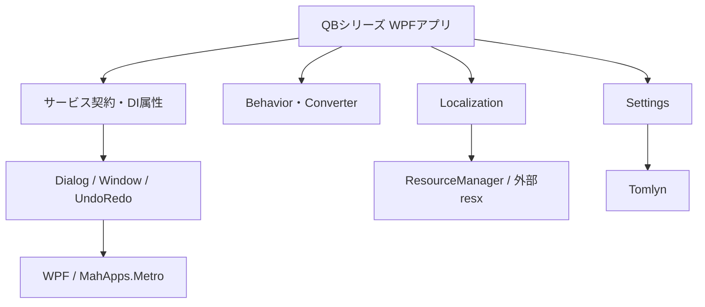

# libQB 概要

## 1. この文書について

本書は 2026-08-04 時点の `libQB` の実装を、開発者向けに整理した概要である。構造把握には `graphify-out/GRAPH_REPORT.md` と `graphify-out/graph.json` を参照したが、記述内容の根拠は `libQB.csproj`、C#、XAML、および参照可能なQBシリーズ各プロジェクトの実コードである。

## 2. libQBとは

`libQB` はQBシリーズのWPFアプリケーションで共用するUI・アプリケーション基盤ライブラリである。特定業務のモデルや画面遷移を実装するのではなく、各アプリで繰り返し必要になる次の横断機能を提供する。

- MahApps.Metro上の共通ダイアログとファイル／フォルダー選択
- DI登録を補助する属性メタデータ
- ViewModelをDIから解決してモーダルWindowを開くサービス
- Undo/Redoの履歴管理とプロパティ変更アクション
- 外部resx言語パックを含むローカライゼーション基盤
- TOML形式の汎用設定ストア
- WPF Behavior、添付プロパティ、値コンバーター
- Light/Darkテーマを表す共通Enum

QBTemplate、QBDrumMap、QBMidiconでは上記の複数機能が実際に利用されている。ほかにQBChordBook、QBConference、QBLipsync、QBPigeonDocからも参照を確認した。

## 3. プロジェクト構成

| パス | 主な責務 |
|---|---|
| `Attributes/` | アプリ側のリフレクションスキャンに渡すDI登録メタデータ |
| `Behaviors/` | ComboBox、Popup、ContextMenu、DataGrid、入力検証のWPF拡張 |
| `DialogServices/` | 共通ダイアログ、OSファイルダイアログ、表示文言の差し込み口 |
| `Enums/` | 共通テーマEnum |
| `Localization/` | 組み込みResourceManagerと外部resxパックを統合する文字列解決 |
| `Settings/` | 永続化方式を抽象化した設定ストアとTOML実装 |
| `UndoRedo/` | Undo/Redoスタック、単一／複合アクション |
| `ValueConverters/` | WPF Binding用コンバーター |
| `WindowServices/` | DI解決したViewModelを持つモーダルWindowの表示と結果返却 |
| `docs/Localization/` | Localizationに関する既存仕様・判断記録 |
| `graphify-out/` | Graphifyによる構造解析結果（補助資料） |

## 4. 対象Frameworkとビルド設定

`libQB.csproj` の現在値は次のとおりである。

| 項目 | 値 |
|---|---|
| Target Framework | `net10.0-windows7.0` |
| UI | WPF（`UseWPF=true`） |
| Nullable | 有効 |
| Implicit Usings | 有効 |
| Platforms | `AnyCPU;x64` |
| NuGet package generation | Build時に有効 |
| Package/Assembly version | `1.1.0` / `1.1.0.0` |
| License expression | MIT |

WPFおよびWindows固有ダイアログを利用するため、汎用のクロスプラットフォーム.NETライブラリではない。READMEの「.NET SDK 8.0以上」という記述は現在のTarget Frameworkと一致しないため、利用側は `net10.0-windows7.0` を基準に互換性を判断する必要がある。

## 5. 外部依存

| パッケージ | バージョン | 用途 | 主な利用箇所 |
|---|---:|---|---|
| `CommunityToolkit.Mvvm` | 8.4.2 | Observable propertyとRelayCommandのソース生成 | `DialogServices/GenericDialogViewModel.cs` |
| `MahApps.Metro` | 2.4.11 | MetroWindow上のカスタムダイアログ | `DialogService.cs`、`GenericDialog.xaml(.cs)` |
| `MahApps.Metro.IconPacks.FontAwesome` | 6.2.1 | アイコンパック依存として参照 | 現在のlibQB実コードではFontAwesome固有型の参照を確認できない |
| `MahApps.Metro.IconPacks.Material` | 6.2.1 | ダイアログのMaterialアイコン | `GenericDialogOptions.cs`、`GenericDialogViewModel.cs`、`GenericDialog.xaml` |
| `Tomlyn` | 2.10.1 | 設定オブジェクトのTOML直列化／逆直列化 | `Settings/TomlSettingStore.cs` |

`Microsoft.Xaml.Behaviors` の `Behavior<T>` はBehavior実装から利用される。`libQB.csproj` に直接のPackageReferenceはなく、現在の依存グラフではMahApps.Metro側から解決されている構成である。

## 6. QBシリーズ内での役割

libQBは「アプリ固有機能の下」に置かれる共通基盤である。アプリ側はサービスのインターフェースをDI登録し、画面・ViewModel・サービスに属性を付け、必要な共通機構を選択して利用する。

DIコンテナー自体や属性スキャン処理はlibQBに含まれない。参照先アプリの `App.xaml.cs` が `DIAttribute` 派生属性を読み取り、Microsoft.Extensions.DependencyInjection等へ登録している。

## 7. 提供していない機能

- DIコンテナー、サービスコレクション、属性スキャナーそのもの
- ナビゲーションやページライフサイクルの統一基盤
- アプリ固有の設定モデル、保存先決定、保存タイミング
- Undo対象の自動検出、履歴永続化、履歴件数制限
- 非モーダルWindow管理、開いているWindowの追跡
- 入力フォームを持つ汎用ダイアログ
- 言語選択の永続化、外部言語フォルダーの配置決定
- テーマを実際に切り替えるサービス
- ロギング、通信、データベース、ドメインモデル

## 8. 利用時の注意

- `DialogService` のMahAppsダイアログは `Application.Current.MainWindow` が `MetroWindow` の場合だけ表示される。それ以外は `ShowGenericDialogAsync` が `null` を返す。
- ファイル／フォルダーダイアログはキャンセル時に、非nullableに見える `Task<string>` から実際にはnullを返す。
- `WindowService.ShowWindow` の `parameter` は使用されない。パラメーター受け渡しは `ShowWindowWithCallback` と `IParameterReceiver` の組み合わせに限られる。
- `WindowService` は型引数のWindowを `new()` し、ViewModelだけを `IServiceProvider` から解決する。Window自体はDI解決されない。
- `TomlSettingStore.Load` はファイル不存在または逆直列化失敗時に `new T()` を返す。一方、ファイルI/O例外やSerializer例外を包括的に捕捉する実装ではない。
- Localizationの外部resxは指定フォルダー直下のカルチャ別サブフォルダーだけを探索する。XML読込例外は呼び出し元へ伝播する。
- `ClearableComboBox.ClearValue` は公開されているが、現在のクリア処理では参照されず、選択肢があれば常に先頭項目を選ぶ。
- `DataGridExtendBehavior.SelectedRowsProperty` の既定値は可変な `List<object>` である。各Behaviorインスタンスで明示的にバインドする利用が安全である。
- MITライセンス本文は利用目的を個人利用に限定していない。READMEの「個人での利用に限り無償」という文言とは一致しないため、正式な条件は `LICENSE.txt` を確認する。

## 9. 関連文書

- [公開型リファレンス](ClassReference.md)
- [アーキテクチャ](Architecture.md)
- [Localization現在仕様](Localization/Specification.md)

